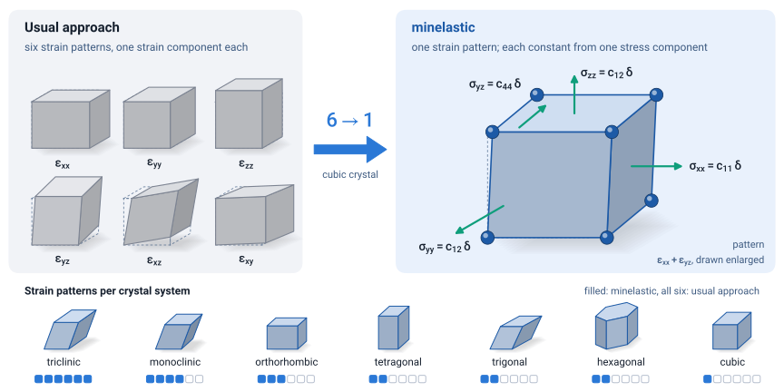

<picture>
  <source media="(prefers-color-scheme: dark)" srcset="docs/assets/wordmark-dark.svg">
  
</picture>

[](https://arxiv.org/abs/2610.11733)
[](https://github.com/utksi/minelastic/actions/workflows/tests.yml)
[](https://utkarsh.science/minelastic/)
[](LICENSE)

Elastic, internal-strain and piezoelectric tensors from the fewest possible stress calculations, for every
crystal symmetry and with any electronic-structure code.

<picture>
  <source media="(prefers-color-scheme: dark)" srcset="docs/assets/hero-dark.svg">
  
</picture>

**minelastic** implements the minimal and uncoupled strain sets scheme of

> S. I. Simak and U. Singh, *A general algorithm for minimal uncoupled stress-strain calculations of
> elastic constants*, [arXiv:2610.11733](https://arxiv.org/abs/2610.11733) (2026).

Each independent elastic constant is read off one stress component of one strained cell, and the number of
strain patterns is the smallest that any stress-strain method can use: one for a cubic crystal and two for
tetragonal, trigonal and hexagonal crystals, where the usual approach (VASP's `IBRION = 6` and most
workflows) applies six. The same strained cells also give the internal-strain tensor and, with Berry-phase
dipoles, the clamped-ion piezoelectric tensor; a few single points with displaced atoms add the relaxed-ion constants,
the Born charges and the total piezoelectric tensors; and molecular dynamics in the strained cells gives the
constants at finite temperature.

## Installation

<!-- skip: installs the package -->
```bash
pip install git+https://github.com/utksi/minelastic.git
```

minelastic requires Python 3.9 or newer; numpy, spglib and ASE are installed with it.

## Usage

With any ASE calculator, in memory:

<!-- run -->
```python
from ase.build import bulk
from ase.calculators.emt import EMT
import minelastic

result = minelastic.calculate(bulk("Cu", "fcc", a=3.59, cubic=True), EMT())
print(result.summary())
```

<!-- output -->
```text
minelastic 0.1.0: Fm-3m (225), cubic, 1 strain pattern(s), method 'uncoupled'
  c11 =     172.50 GPa
  c12 =     115.35 GPa
  c44 =      89.84 GPa
...
Born stable: True (eigenvalues 57.2, 57.2, 89.8, 89.8, 89.8, 403.2)
K_VRH = 134.40  G_VRH = 56.85  E = 149.48 GPa  nu = 0.315  A_U = 1.755
...
```

With a DFT code, minelastic writes the inputs of the strained cells from the input of the relaxed structure
and reads the finished calculations:

<!-- skip: needs a VASP template and the VASP runs -->
```bash
# ref/ holds POSCAR, INCAR, POTCAR and KPOINTS of the relaxed structure
minelastic generate vasp ref/ -o el
# run VASP in every directory listed in el/STATES
minelastic collect el     # prints the constants, writes el/elastic.json
```

VASP, Quantum ESPRESSO, ABINIT, FHI-aims and every structure format that ASE writes are supported, and any
ASE calculator (EMT, MACE, CP2K, ...) can be used directly.

## Documentation

The documentation at https://utkarsh.science/minelastic/ contains tutorials for VASP, Quantum ESPRESSO,
ABINIT and CP2K, how-to guides for every quantity, the theory with all formulas, and the validation against
the codes' own elastic, internal-strain, Born-charge and piezoelectric tensors. Runnable scripts are in
[`examples/`](examples).

## Citing

If you use minelastic in published work, please cite the paper:

```bibtex
@misc{simak2026minimal,
  title         = {A General Algorithm for Minimal Uncoupled Stress--Strain
                   Calculations of Elastic Constants},
  author        = {Simak, Sergei I. and Singh, Utkarsh},
  year          = {2026},
  eprint        = {2610.11733},
  archivePrefix = {arXiv},
  primaryClass  = {cond-mat.mtrl-sci},
  doi           = {10.48550/arXiv.2610.11733}
}
```

## Tests and license

`pip install -e ".[test]" && pytest tests` runs the tests. They use stored stresses of real calculations,
among them the paper's benchmark runs for all nine elastic types, and they run every code example of the
documentation, so no DFT code is needed.

minelastic is distributed under the MIT license ([LICENSE](LICENSE)). It was developed at the Department of
Physics, Chemistry and Biology (IFM), Linköping University. Questions and bug reports are welcome as GitHub
issues.
